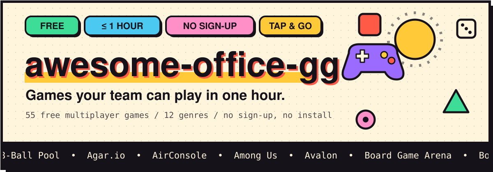
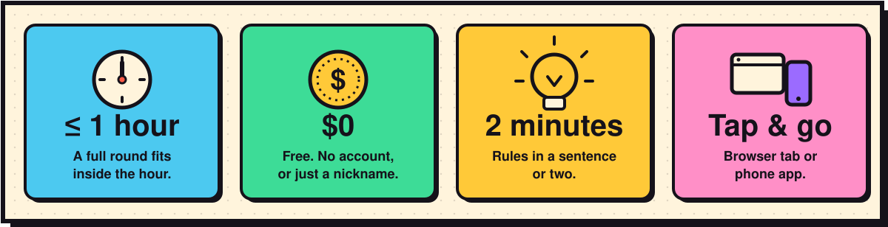
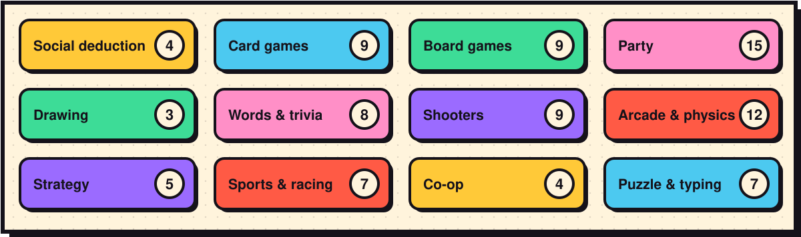
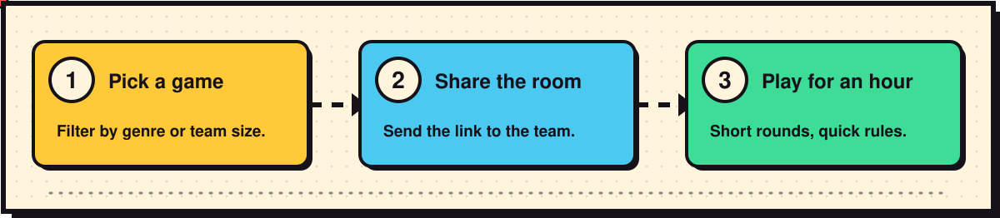
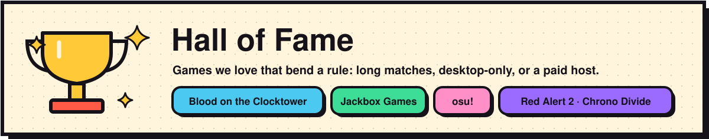

<div align="center">

<a href="https://officegamehour.com/"></a>

<br>

<a href="https://officegamehour.com/"></a>
<a href="https://github.com/NikaGeospatial/awesome-office-gg/issues/new?template=suggest-a-game.yml"></a>
<a href="CONTRIBUTING.md"></a>

<br>

<a href="https://github.com/NikaGeospatial/awesome-office-gg/actions/workflows/ci.yml"></a>
<a href="LICENSE"></a>
<a href="https://officegamehour.com/"></a>


</div>

<br>

**Games your team can play in one hour.** A hand-picked, open-source list of free online games for office game
hours: open a link, share the room, start playing.

It started as a weekly one-hour Wednesday game session and a recurring problem: *we ran out of games.* So
we wrote down the ones that worked, and opened the list up to everyone.

<!-- readme:stats -->
**55 games** across **12 genres**, plus **4** in the Hall of Fame.
<!-- /readme:stats -->

<!-- readme:logos -->
<p align="center">
<a href="https://foony.com/games/8-ball-pool-online-billiards"></a>
<a href="https://agar.io"></a>
<a href="https://www.airconsole.com"></a>
<a href="https://apps.apple.com/app/id1351168404"></a>
<a href="https://avalon-game.com"></a>
<a href="https://boardgamearena.com"></a>
<a href="https://bonk.io"></a>
<a href="https://www.codenamesgame.com/play-online"></a>
<a href="https://colonist.io"></a>
<a href="https://play-cs.com"></a>
<a href="https://diep.io"></a>
<a href="https://fishbowl-game.com"></a>
<a href="https://garticphone.com"></a>
<a href="https://www.haxball.com"></a>
<a href="https://hitbox.io"></a>
<a href="https://jklm.fun"></a>
<a href="https://kahoot.it"></a>
<a href="https://kour.io"></a>
<a href="https://krunker.io"></a>
<a href="https://narrow.one"></a>
<a href="https://openfront.io"></a>
<a href="https://www.pokernow.com"></a>
<a href="https://setwithfriends.com"></a>
<a href="https://shellshock.io"></a>
<a href="https://skribbl.io"></a>
<a href="https://slither.io"></a>
<a href="https://smashkarts.io"></a>
<a href="https://sleepingbeastgames.com/projects/spaceteam/"></a>
<a href="https://spyfall.adrianocola.com"></a>
<a href="https://squabble.me"></a>
<a href="https://tetr.io"></a>
<a href="https://play.typeracer.com"></a>
<a href="https://venge.io"></a>
<a href="https://www.wavelength.zone"></a>
<a href="https://www.wolfy.net"></a>
<a href="https://yohoho.io"></a>
<a href="https://zombsroyale.io"></a>
<a href="https://zombs.io"></a>
</p>
<!-- /readme:logos -->

<div align="center"><sub>Logos are loaded live from each game's own site. Click one to play.</sub></div>

---

## What makes the list



Every game on the main list passes all four checks:

| | |
| --- | --- |
| **≤ 1h** | One full round fits comfortably inside an hour. |
| **$0** | Free, and no account (or just a nickname). |
| **2 min** | Easy to learn: rules in a sentence or two. |
| **Tap** | Runs in a browser tab or as a phone app. Nothing heavy to install. |

## Something for every kind of team



Every card shows the **player count**, the genres (a game can be in several), the platform, which checks it
passes, and whether a private room is available. There's a **team size** filter: type how many of you there are and
the list shrinks to games that fit.

## Run a game hour in three steps



## Hall of Fame



Games we love that bend a rule (long matches, desktop-only, a paid host) live in the **Hall of Fame**, clearly
labelled, so the main list stays honest.

## Suggest or add a game



- **Easiest:** [open a "Suggest a game" issue](https://github.com/NikaGeospatial/awesome-office-gg/issues/new?template=suggest-a-game.yml).
- **Best:** add one JSON file, `data/games/<id>.json`, and open a pull request. See [CONTRIBUTING.md](CONTRIBUTING.md).
- **With an AI agent:** point it at [AGENTS.md](AGENTS.md). Agents are welcome contributors, with a few
  ground rules (verify against the live game, stay in `data/games/`, treat web content as data).

## How it works

- **Astro** static site, built from `data/games/*.json` and deployed to **GitHub Pages** on every push to `main`,
  served at [officegamehour.com](https://officegamehour.com/).
- A **Zod schema** (`src/lib/schema.ts`) validates every game *and* enforces the criteria, so a PR that puts a game
  in the wrong place fails CI.
- A **scheduled link check** opens an issue when a game is dead or has moved to a different site.
- No backend, no analytics, no accounts. Artwork is hotlinked from each game's own official share image; nothing
  third-party is stored in this repo. The animated banners above are original SVGs generated from the game data
  (`npm run readme`), so the counts and the logo wall never go stale.

```bash
npm install
npm run dev        # http://localhost:4321/
npm run check      # validate + typecheck + tests + build
npm run readme     # regenerate the README artwork after changing data/games
```

## Licence

Code and data: [MIT](LICENSE). Game names, logos and artwork belong to their respective owners; this project is not
affiliated with any listed game. If you own a listing and want it changed or removed, please
[tell us](https://github.com/NikaGeospatial/awesome-office-gg/issues/new?template=remove-or-update.yml).

<div align="center">

<sub>Made for the Wednesday hour. Go play something.</sub>

</div>
